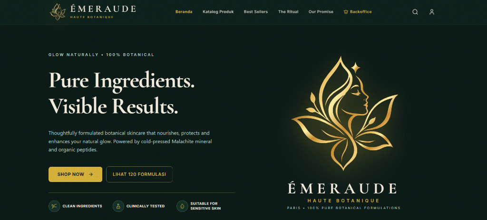

<div align="center">

# 🌿 ÉMERAUDE BOTANICA
### *Haute Cosmétique, Luxury Skincare & Botanical Wellness Store*

[](https://react.dev/)
[](https://www.typescriptlang.org/)
[](https://vitejs.dev/)
[](https://tailwindcss.com/)
[](https://vitest.dev/)
[](https://github.com/pranataa-labs)
[](LICENSE)

<br/>



<br/>
<br/>

*Aplikasi e-commerce kosmetik botani dan perawatan kulit mewah dengan arsitektur dua sisi (**Public Luxury Boutique & Maison Admin Backoffice**) yang dirancang menggunakan palet eksklusif **Deep Velvet Emerald (`#091D18`)**, **24K Royal Gold (`#D4AF37`)**, dan efek **Tactile Micro-Grain/Noise** bertekstur elegan.*

---

</div>

## 🎨 Palet Identitas & Desain Mewah

| Swatch | Kode Hex | Label Warna | Peran Visual dalam Aplikasi |
| :---: | :---: | :--- | :--- |
|  | **`#091D18`** | **DEEP VELVET EMERALD** | Warna primer utama butik, navbar lengket, kartu produk, dan footer dengan efek grain |
|  | **`#D4AF37`** | **24K ROYAL GOLD** | Logo vektor Dewi Lotus, tombol CTA utama, aksen harga, border kemewahan, dan bintang rating |
|  | **`#F2EBDD`** | **IVORY ALABASTER** | Tipografi judul dan teks gading kontras tinggi yang nyaman dibaca |
|  | **`#78947F`** | **BOTANICAL SAGE** | Label formulasi sekunder, volume flacon, dan chip kebutuhan kulit |

---

## 🌟 Fitur Utama Aplikasi

### 1. Arsitektur Multi-Halaman (Bukan One-Page)
- **Halaman Beranda (`activeView === 'store'`)**:
  - **Floating Gold Lotus Emblem**: Logo Dewi Lotus emas melayang bebas tanpa bingkai kotak penutup (*card-free*), didukung pencahayaan *ambient gold glow* lembut.
  - **Category Icon Strip**: Tombol ikon minimalis untuk melompat langsung ke halaman katalog per kategori.
  - **Section "Produk Paling Banyak Dibeli" (Best Sellers)**: Menampilkan kurasi 10 produk terlaris di beranda, dengan tombol navigasi menuju katalog lengkap 120 formulasi.
  - **Dual Editorial Banners Sempurna & Simetris**: Bagian *The Ritual* dan *Our Promise* dengan tata letak proporsional dan ukuran gambar yang presisi seimbang.
  - **Press Bar & VIP Newsletter**: Liputan media mewah (*Vogue*, *Bazaar*, *Allure*, *Elle*) dan formulir langganan diskon 15%.

- **Halaman Katalog Produk Tersendiri (`activeView === 'catalog'`)**:
  - Halaman penuh khusus untuk menjelajahi **seluruh 120 produk** (20 formulasi per kategori).
  - Filter kategori instan (*Semua*, *Serum & Essence*, *Moisturizer & Cream*, *Cleanser & Toner*, *Lip & Cheek Couture*, *Eye & Night Ritual*, *Body & Wellness*).
  - Filter tipe kulit (*Kulit Kering*, *Berminyak & Acne*, *Sensitif*, *Anti-Aging*).
  - Fitur sortir cerdas (*Paling Banyak Dibeli*, *Rating Tertinggi*, *Harga Terendah/Tertinggi*) serta pencarian kata kunci dan filter favorit (wishlist).

- **Halaman Detail Produk Mandiri (`activeView === 'product'`)**:
  - Halaman penuh khusus untuk setiap produk (bukan modal popup).
  - Navigasi *Breadcrumb* interaktif: `Beranda > Katalog Koleksi > [Kategori] > [Nama Produk]`.
  - Foto flacon kosmetik resolusi tinggi dengan badge sertifikasi resmi **Nomor Registrasi BPOM RI**, jaminan **100% Vegan & Halal**, dan volume bersih.
  - Rincian lengkap *Key Botanical Actives*, panduan *Ritual Pemakaian*, pemilih jumlah (*quantity*), tombol **Tambah ke Tas Belanja**, dan tombol **Beli Sekarang**.
  - Rekomendasi 5 produk terkait dalam kategori yang sama di bagian bawah halaman.

### 2. Transaksi & Checkout Cerdas
- **Tas Belanja Eksklusif (*Cart Drawer*)**:
  - Pemilih hadiah gratis (*Complimentary Luxury Vial Gift* 3ml).
  - Indikator gratis ongkir pesanan di atas Rp 500.000.
  - Dukungan voucher diskon (`EMERALD15` hemat 15%, `ROYALGOLD` potongan Rp 120.000).
- **Checkout Cerdas (Deteksi Kode Pos Indonesia)**:
  - Input kode pos otomatis mengisi Provinsi, Kota, dan Kecamatan secara instan.
  - Pilihan ekspedisi kurir aman (*JNE YES Luxury*, *White-Glove Same Day*, *SiCepat BEST*).
  - Multi-metode pembayaran (QRIS, Transfer Bank BCA/Mandiri, Kartu Kredit, COD).
  - E-Invoice resmi dan pelacakan status pesanan.

### 3. Maison Admin Backoffice
- **Dashboard Eksekutif**: 4 Kartu KPI (*Total Pendapatan*, *Unit Flacon Terdistribusi*, *Formulasi Aktif*, *Member VIP*) serta grafik omzet berkala.
- **Manajemen Formulasi (CRUD)**: Tambah formulasi baru dengan *drawer sheet*, ubah harga, stok, nomor BPOM, bahan aktif, dan hapus SKU.
- **Manajemen Pesanan**: Pembaruan status pesanan (*Pending → Dibayar → Dikemas → Dikirim → Selesai*).
- **Database Member VIP & Analisis Kulit**: Pemetaan preferensi jenis kulit member terdaftar.


---

## 🧪 Verifikasi & Pengujian (Testing)

Proyek ini telah diverifikasi menggunakan rangkaian unit test otomatis Vitest:

```bash
# Menjalankan pengujian Vitest
pnpm test
```

Hasil verifikasi:
```text
✓ src/tests/cosmetics.test.ts (6 tests)
  ✓ INITIAL_PRODUCTS contains exactly 120 products
  ✓ every category contains exactly 20 products
  ✓ all products have required luxury cosmetic properties
  ✓ seed orders have valid totals and customer data
  ✓ complimentary samples list contains luxury vials
  ✓ category list contains all 6 core cosmetic divisions
```

---

## 🛠️ Panduan Menjalankan Proyek Secara Lokal

### Prasyarat
- Node.js (v18 ke atas, disarankan v20+)
- pnpm atau npm

### Langkah Instalasi
```bash
# 1. Masuk ke direktori repositori
cd emeraude-cosmetics

# 2. Pasang paket dependensi
pnpm install

# 3. Jalankan server pengembangan lokal
pnpm dev --port 5174
```

Aplikasi dapat diakses langsung pada peramban di **[http://localhost:5174/](http://localhost:5174/)**.

### Kompilasi & Build Produksi
```bash
pnpm run build
```

---

## 📄 Lisensi
Dilisensikan di bawah [MIT License](LICENSE).

<div align="center">
  <sub>Designed &amp; Engineered with pride by <a href="https://github.com/pranataa-labs">Pranataa Labs</a></sub>
</div>
